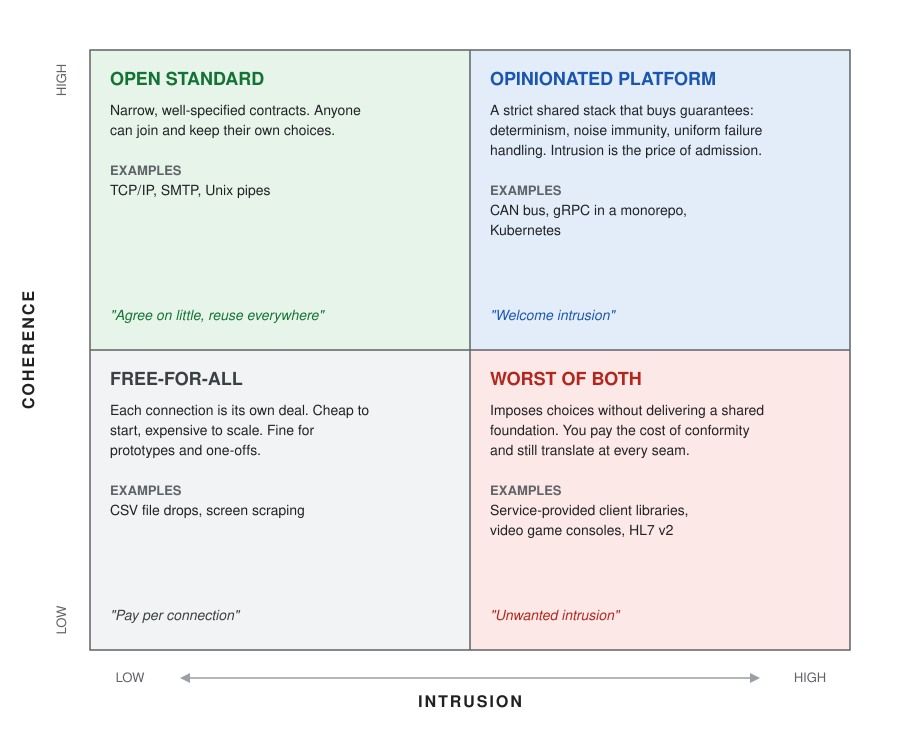
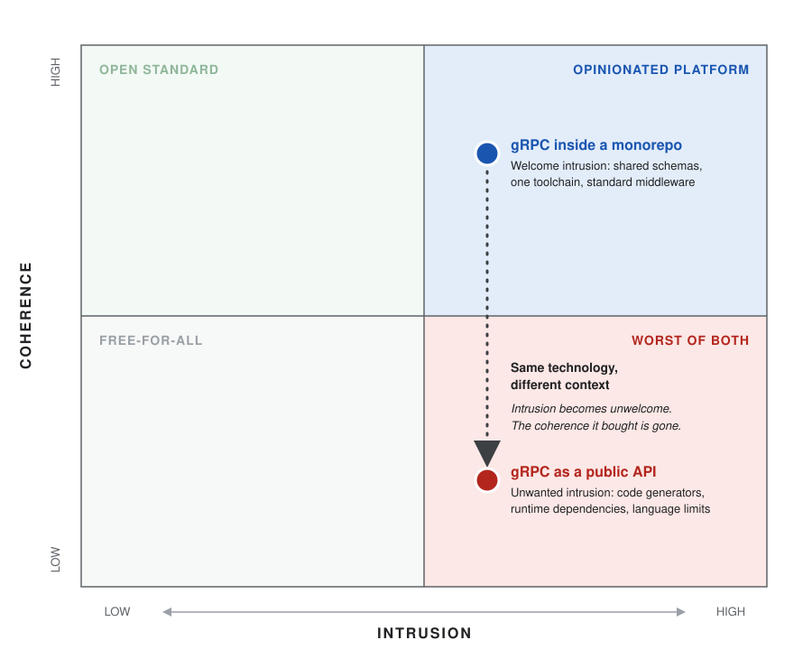

# Coherence and Intrusion - Properties of an Interoperable Platform

When we talk about interfaces of systems, we often use the words coupling and cohesion. Good interfaces are cohesive. Their elements belong together. They also strive to minimize coupling. Changes in one don't force changes in another. Dependency between them is minimized.

These concepts have served us well for many decades when describing the properties of interfaces, but I find they don't adequately express the properties of interoperability. When talking about interoperability, coupling is inevitable. In fact, it's the entire point. If two systems are communicating, they are, by definition coupled. A change to one side forces a change to the other. Cohesion describes the interface, but doesn't in itself affect interoperability. Incohesive APIs may be difficult to comprehend, but they aren't more difficult to call.

Thinking from the perspective of interoperability, I'd like to introduce two new dimensions: _Coherence_ and _Intrusion_.

## Coherence

Coherence describes the ease of interoperating between two systems, based on a consistent shared technical understanding. For example, the REST protocol is coherent. JSON serialization, HTTP transport semantics, TCP sessions, and IP addressing and routing are well understood and well-specified standards. Conforming to this standardized stack makes interoperability predictable. Predictable interoperability is repeatable interoperability, which lends itself to shared libraries and easy implementation.

While REST is reasonably coherent, gRPC is even more coherent. gRPC replaces the only somewhat standardized JSON serializer with the more rigorously specified Protobuf serializer. It formalizes message streaming with HTTP/2, and formally defines the error handling semantics lacking in REST. Bespoke binary protocols are the opposite of coherent. When every detail is bespoke, every detail is a one-off implementation.

The real power of coherence emerges as the number of connections grows. When coherence is low and every connection is point-to-point, there are few opportunities for code sharing. The challenge of connecting the output of one system to the input of another grows worse as more systems are integrated. The cost of translation can quickly dwarf the value of the connections. On the other hand, highly coherent platforms maximize code reuse and lend themselves to easily plugging systems together. The output of one naturally fits into the input of the next.

## Intrusion

If coupling says "my change is now your change", intrusion says "my choice is now your choice". Highly opinionated platforms are naturally intrusive. They force choices upon platform participants and take away degrees of freedom in the name of overall platform harmony. Welcome intrusion leads to coherence. Unwanted intrusion leads to complication.

Service-provided client libraries are often unnecessarily intrusive. They only exist for a chosen set of languages. They often come with complex transitive dependency chains. They sometimes make assumptions about the framework they operate within. Worse, they might even leak generated datatypes beyond their interface, forcing the caller to interact with clumsy or error-prone APIs.

Intrusion cannot be avoided. For two components to collaborate, they have to agree on something, but like coupling, we can seek to minimize unnecessary intrusion in our designs. Platforms built on open standards with minimal dependencies maximize coherence while minimizing unwanted intrusion. Collaborators can easily communicate without sacrificing agency.

## Design Choices

Coherence and intrusion are not binary properties. Like cohesion and coupling, they exist on a continuum. Also like cohesion and coupling, coherence and intrusion aren't inherently "bad" when explicitly designed for. Accidental incoherence and unwanted intrusion are where problems arise.

### High Coherence, High Intrusion

The high/high quadrant is the realm of highly opinionated platforms and "paved path" design. The core value here is leverage and reuse. Enforced standardization maximizes the utility of shared tooling, at the expense of choice.

Examples include:

* The [CAN bus](https://en.wikipedia.org/wiki/CAN_bus) used heavily in the automotive industry. Custom microcontrollers and chips ensure uniform interoperability in a challenging environment.
* A single monorepo built around gRPC. One programming language, one toolchain for code generation, and a single source of truth for service contracts.
* The Kubernetes platform. Everything is modeled as containers, YAML resources, and reconciling controllers. A vast ecosystem has grown around this platform specifically because the interfaces are so standardized.

### High Coherence, Low Intrusion

The high/low quadrant is the home to open standards. This is the quadrant that describes most of the internet. The core value here is maximized interoperability. Standards describe how systems communicate, but say nothing about their implementation. An unfortunate consequence of this approach is that the most successful standards are also the hardest to evolve.

Examples include:

* TCP/IP. Arguably the most successful interoperability standard in history and the foundation of the internet. IPv4 has remained relatively unchanged since the 1980s. IPv6 was standardized in 1996 and still struggles with adoption.
* SMTP. The protocol that powers all email, but is also the source of spam. Preventing spam has proven to be nearly impossible specifically due to the open nature of the protocol.
* Unix Pipes. Processes share information by streaming lines of text between each other. The output of one is the input of the other. The Unix Way gave rise to much of modern computing, but struggles exchanging anything more complicated than line-oriented ASCII text.

### Low Coherence, Low Intrusion

The low/low quadrant is the "just get it done" quadrant. Not every project has the freedom to dictate terms or impose standards. Sometimes you just have to find a way to make it work with what you have. Many back-office enterprise systems live here. The job gets done, but often at the expense of future maintainability.

Examples include:

* Exchanging CSV file drops. CSV has no enforced standard, and no formal schema, but it's nearly trivial to read and process.
* Screen scrape automation. HTML was not meant for machine-to-machine interoperability, but in a pinch it _can_ be scraped. Automation built by scraping web pages and filling out forms can work when no other option is available.
* Swivel-chair integration. A human reads data from one system and inputs it into another. The lack of any shared understanding between systems undermines machine-to-machine interoperability, forcing a human judgement to mediate the exchange. As a consolation, neither system has to change to adapt to the other.

### Low Coherence, High Intrusion

The low/high quadrant is the worst of both worlds. Integrations in this quadrant often suffer from partial standardization. Just enough structure to make integration complicated, but with vendor-specific caveats that undermine interoperability.

Examples include:

* Service-provided client libraries. Client libraries only work in the language they were written in, and often drag along unwanted dependencies which sometimes conflict with each other. Client libraries with incompatible idioms add friction when integrating them together.
* Video game consoles. Every console is a unique and highly optimized computing environment, yet game developers are expected to support all of them simultaneously. Many titles are rewritten nearly from scratch to port from one to another.
* HL7 v2. A data interchange format for exchanging medical data between electronic health record systems. The standard suffers from unnecessarily complex pipe-delimited data parsing rules, multiple ways of accomplishing the same task, and vendor-specific extensions. No two integrations are the same.

## Coherence and Intrusion in Practice

Technology and design choices do not exist in isolation. How they affect coherence and intrusion depends entirely on the context in which they are applied.

gRPC can make a strong foundation for a highly coherent developer experience within a monorepo behind a company firewall. Protobuf schemas can be easily shared within the repo. Standardized build tooling can generate client and server stubs, maintaining consistency and reducing boilerplate. The technology's natural intrusion can be leveraged to build standardized middleware for authentication, authorization, logging, and tracing.

And yet, choosing gRPC for public APIs completely changes the equation. Protobuf schemas are difficult to distribute while keeping clients up to date. Code generators impose restrictions on which programming languages a customer can use. Shared middleware becomes a liability that must be ported to different languages and kept up to date. Finally, third-party dependencies on the gRPC runtime, protobuf libraries, and shared Google code can cause dependency conflicts with customer codebases.

The high intrusion of gRPC can be an asset when used as the foundation for an opinionated and coherent internal platform, but can become a liability when exposed to the idiosyncrasies of the open internet. A change in context can move it from the high/high quadrant to the low/high quadrant. Even worse, if yours is the only gRPC API your customers integrate with, choosing it may inadvertently _decrease_ the coherence of _their_ codebases by forcing them to adopt a technology they never chose.

## Choosing Deliberately

Coupling and cohesion tell us how well a single component is built. They say little about how easily independent systems can work together. Coherence and intrusion fill that gap. Coherence tells us how much we gain from a shared understanding. Intrusion tells us what that understanding costs the people who must adopt it.

Neither is a goal in itself. A paved path is a gift to the teams who chose to walk it and a burden to those who didn't. Before adopting or exposing an interface, ask two questions: How much coherence does this buy? And whose choices does it take away? When the intrusion is welcome, the platform gains leverage. When it isn't, it only gains complication.